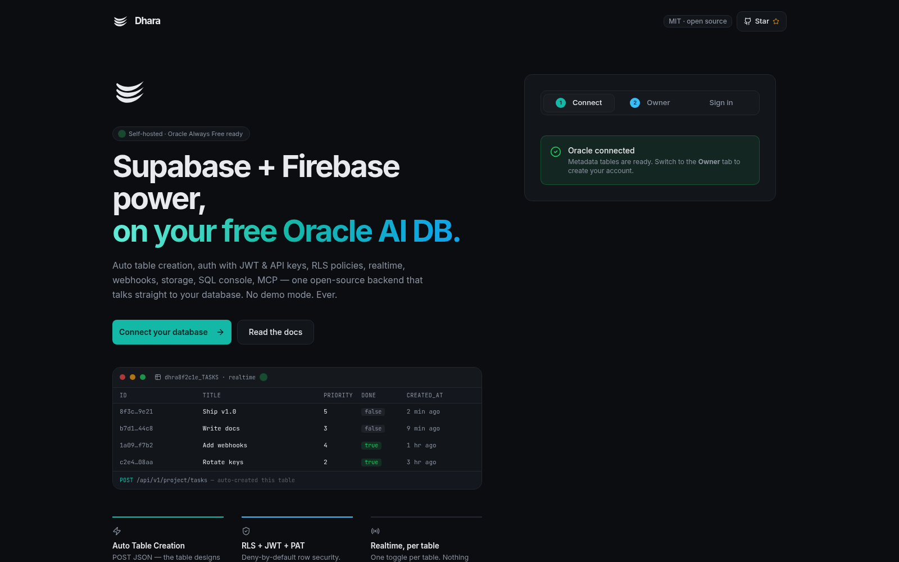
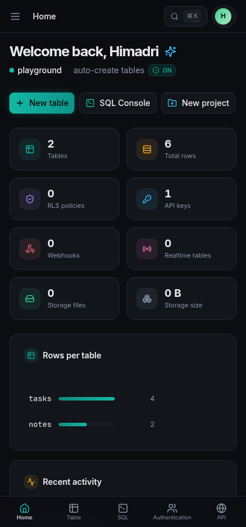
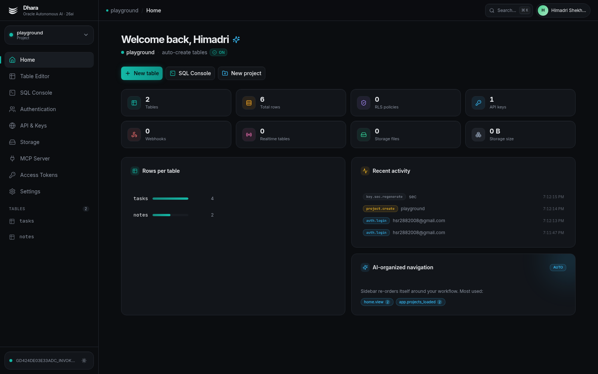
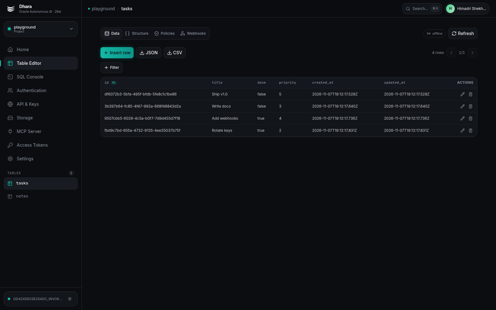

<div align="center">


# Dhara

**The open-source backend platform that runs entirely on your free Oracle Autonomous AI Database.**

*Supabase's developer experience × Firebase's simplicity — on Oracle's Always Free tier. No demo mode, ever.*

[](LICENSE)
[](https://nodejs.org)
[](https://nextjs.org)
[](https://www.oracle.com/autonomous-database/)
[](CONTRIBUTING.md)

**Auto tables** · **Auth (JWT / OAuth / API keys / PATs)** · **RLS policies** · **Realtime per table** · **Webhooks** · **Storage** · **SQL console** · **REST API v1** · **MCP server** · **AI-organized dashboard**

</div>

---

| Desktop | Mobile |
|---|---|
|  |  |

| Dashboard | Table Editor |
|---|---|
|  |  |

---

# 🫴 The complete walkthrough — zero to your first API call

This guide holds your hand through **every single click**. Budget: **~15 minutes**, everything free.

## What you need before starting

- A computer with **Node.js 20+** installed ([nodejs.org](https://nodejs.org) → LTS installer → next-next-next)
- A terminal (Terminal.app / PowerShell / any shell)
- That's it. Oracle gives you the database for $0.

---

## Step 1 — Create your free Oracle database

1. Go to **[oracle.com/cloud/free](https://www.oracle.com/cloud/free)** and click **Start for free**.
2. Fill the sign-up (name, email, card for verification — **you will not be charged** on Always Free).
3. Once logged in to the Oracle Cloud console, open the ☰ menu → **Oracle Database → Autonomous AI Database**.
4. Click **Create Autonomous AI Database**.
5. Fill it in like this:
   - **Display name:** `dhara` (anything you like)
   - **Workload type:** any works — pick *Transaction Processing*
   - **Instance type:** 🔘 **Free**
   - **Database credentials:**
     - **Username:** `ADMIN` (default, keep it)
     - **Password + confirm:** make one up — 12+ chars with an uppercase, a lowercase and a number, e.g. `MyDhara2026!x`. **Write it down** — you'll type it twice in a minute.
   - **Network access:** 🔘 *Allow secure access from everywhere* (simplest; you can tighten it later)
6. Click **Create Autonomous AI Database**.
7. Wait until the colored dot next to your database turns **green (Available)** — usually 2–5 minutes. ☕

## Step 2 — Get your connection details

While the database turns green, decide how Dhara will connect:

- **Option A — Wallet (mTLS)** — the normal path for free-tier databases:
  1. On your database's detail page, click **Download wallet**.
  2. Set a **wallet password** (8+ chars — can be the same as your DB password) and click **Download**. You get a ZIP — keep it.
- **Option B — TLS connection string** (if your DB allows TLS without mTLS):
  1. On the detail page, click **Database connection**.
  2. Copy a **TNS connection string** — prefer one ending in `_tp` or `_low`.

> 💡 Both work. If one fails, the other usually succeeds. Option A is the safe default.

## Step 3 — Run Dhara on your machine

Open your terminal:

```bash
git clone https://github.com/himadrijunior/Dhara.git dhara
cd dhara
npm install          # or: bun install
npm run dev          # or: bun run dev
```

Open **http://localhost:3000** — you'll see the Dhara landing page with the **Connect / Owner / Sign in** panel.

## Step 4 — The Setup Wizard (connect your Oracle DB)

1. In the **① Connect** tab:
   - **DB username:** `ADMIN`
   - **DB password:** the password from Step 1
   - **Connection method:** 🔘 *TLS (easy)* → paste your connection string, **or** 🔘 *Wallet (mTLS)* → upload the ZIP from Step 2 (+ wallet password if asked)
2. Click **Test & Connect**.
3. Within a few seconds you'll see the green **"Oracle connected"** card. Behind the scenes Dhara just created ~17 metadata tables (`DHARA_*`) inside your schema — that's the entire footprint.

**It failed?** Check the error message against the [troubleshooting table](#-troubleshooting) below.

## Step 5 — Create your owner account

1. Switch to the **② Owner** tab.
2. Enter your **name**, **email** and a **password** (min 8 chars) → click **Create owner account**.
3. You're in — **the first account is always the platform owner**. The dashboard greets you with *"Welcome back"*. 🎉

## Step 6 — Create your first project + API key

Dhara organizes everything into **projects** (like Supabase organizations) — each project gets its own tables, keys and policies inside the same Oracle schema.

1. In the sidebar, click the project switcher → **New project** (or the **New project** button on Home).
2. Name it `playground` → **Create**.
3. Go to **API & Keys** in the sidebar.
4. Click **Create key → anon (pub)**. A `dh_pub_…` key appears **exactly once** — copy it somewhere safe.
5. (For server-side scripts you'd also create a **service (sec)** key — `dh_sec_…`. Never put that one in a browser.)

## Step 7 — Your first API call

Replace `<PROJECT_ID>` (shown on Home / API & Keys) and `<dh_pub_KEY>`:

```bash
# INSERT — the "tasks" table does not exist yet. Watch what happens.
curl -X POST "http://localhost:3000/api/v1/<PROJECT_ID>/tasks" \
  -H "x-api-key: <dh_pub_KEY>" \
  -H "content-type: application/json" \
  -d '{"title":"Hello Dhara","done":false,"priority":5}'
```

Response: `201` with your row — including `id`, `created_at`, `updated_at` that Dhara added automatically. The `tasks` table **designed and created itself** from your JSON.

Now read it back:

```bash
curl "http://localhost:3000/api/v1/<PROJECT_ID>/tasks?select=title,done&order=priority.desc&limit=10" \
  -H "x-api-key: <dh_pub_KEY>"
```

Filter operators: `eq neq gt gte lt lte like ilike in is` · pagination: `limit` / `offset`.

## Step 8 — See your data

Open **Table Editor** in the sidebar → click **tasks**. Your row is right there in a spreadsheet-style grid — edit cells, insert rows, toggle **Realtime** per table, or drop the table. Everything you do here is real Oracle DDL/DML.

## Step 9 — Explore the rest (5 minutes each)

| Where | What to try |
|---|---|
| **SQL Console** | `SELECT table_name FROM user_tables ORDER BY 1;` — see Dhara's metadata tables and your project tables (`DHRxxxxxx_TASKS`) |
| **Authentication** | Your owner account lives here; create member accounts for teammates |
| **API & Keys ▸ Policies** | Add a policy: action `all`, roles `authenticated`, USING `user_id = auth.uid()` — deny-by-default turns into "users only touch their rows" |
| **API & Keys ▸ Webhooks** | Point a webhook at [webhook.site](https://webhook.site), toggle Realtime ON on `tasks`, insert a row, watch the signed delivery land |
| **Access Tokens** | Create a **Read-only** PAT — give it to the MCP server / CLIs / AI assistants |
| **MCP Server** | Copy the ready-made config into Claude Desktop and ask it to list your tables |
| **Settings** | Rename your instance, add Google OAuth, switch Storage driver |

## Step 10 — Put it on the internet

When you're ready to deploy (Docker Compose, an Oracle Cloud Always Free VM, Caddy TLS, backups):

→ **[docs/05-self-hosting.md](docs/05-self-hosting.md)** — 10 more minutes, still $0.

---

# 🔧 Troubleshooting

| Error you see | What it means | The fix |
|---|---|---|
| `ORA-12506` / connection timeout | Wrong service name or a firewall | Re-copy the connection string; try the `_low` or `_tp` alias |
| `ORA-01017: invalid username/password` | DB credentials wrong | Re-enter the ADMIN password from Step 1 (not your wallet password) |
| `ORA-28786` / wallet errors | Wallet password wrong or ZIP corrupted | Re-download the wallet; wallet password ≠ DB password necessarily |
| `NJS-505` + `bad decrypt` | Thin mode can't read an Auto-Login (`cwallet.sso`) wallet without the password | Re-enter the **wallet password** you set at download (Setup → Connection); if lost, re-download the wallet and set a new one |
| `NJS-516` / `no configuration directory` | Wallet uploaded but TNS alias can't resolve | Fixed in v1.1.1 — pull latest; or re-run Setup so the wallet path is re-registered |
| `NJS-xxx` TLS errors | Free-tier DB requires mTLS | Use the **Wallet** option in Step 4 |
| `428 not_configured` from the API | Setup wizard never completed | Finish Step 4 on this machine/volume |
| Signup says "Email already registered" | Your DB already had an owner | Sign in instead — or reset via `node scripts/set-owner-password.mjs <email> <newpass>` |

---

# 📚 Full documentation

| # | Document | Contents |
|---|---|---|
| — | [Docs home & TOC](docs/README.md) | All guides, one page |
| 1 | [Setup Guide](docs/01-setup-guide.md) | Oracle DB creation, TLS vs wallet, wizard, owner account |
| 2 | [User Guide](docs/02-user-guide.md) | Every dashboard screen in detail |
| 3 | [API Reference](docs/03-api-reference.md) | Data API v1, Auth API, Management API, webhooks, MCP |
| 4 | [Architecture](docs/04-architecture.md) | How Dhara maps onto Oracle internals |
| 5 | [Self-Hosting](docs/05-self-hosting.md) | Docker, OCI VM, systemd, backups, upgrades |
| 6 | [Security](docs/06-security.md) | Threat model, key storage, RLS guarantees, hardening |
| 7 | [Security Audit](docs/07-security-audit.md) | v1.1.0 full audit + v1.1.1 addendum: findings fixed, 57-check pentest suite |

# 🕘 Changelog

| Version | What changed |
|---|---|
| **v1.1.1** | Thin-mode wallet fix (`configDir` → TNS aliases resolve; cold-start connect 878 ms), pentest tooling hardened (process-group kill, credentials read from env/untracked files only), 57/57 re-verified incl. MCP smoke test |
| **v1.1.0** | Security hardening: tenant isolation everywhere, PAT scopes, SSRF guard, SQL privilege gates, rate limiting, audit log — 9 findings fixed, 57/57 pentest |
| **v1.0.0** | First open-source release: auth, projects, tables, data API v1, storage, webhooks, SQL console, MCP server, PWA |

# ✨ Feature matrix

| Area | Features |
|---|---|
| **Database** | Multi-project, auto table creation from JSON, 9 column types, row editor grid, per-table realtime toggle, RLS policy compiler, SQL console with history & saved queries |
| **Auth** | Email+password (JWT + rotating refresh), Google OAuth, user management, provider linking |
| **API** | Auto REST per table, `dh_pub_`/`dh_sec_` keys, scoped PATs (Full / Read-only / Specific), API Explorer, rate limiting |
| **Realtime** | Per-table on/off + event mask, signed webhook deliveries with logs, WebSocket bridge example |
| **Storage** | Buckets & files on **your host's disk** (default driver), OCI Object Storage adapter (UI switch *Upcoming*) |
| **Platform** | MCP server (HTTP + stdio bridge), audit log, usage tracking, AI-driven nav ordering, ⌘K palette, dark/light, full mobile layout, PWA installable |

# 🧱 Architecture in one line

```
Next.js 16 dashboard + API routes ──► node-oracledb (thin, TLS/mTLS) ──► YOUR Oracle Autonomous AI DB
                                                   │
                    realtime bridge · MCP · webhooks · host-disk storage
```

All instance configuration lives in `.dhara/config.json` (mode `0600`, git-ignored) on **your** server. Your data lives in **your** Oracle schema. Deleting Dhara deletes nothing you can't live without — your tables stay yours.

# 🔒 Security (summary)

- Passwords → bcrypt · API keys & PATs → SHA-256 hashed at rest, shown once
- 100% bind variables + identifier validation — no string-built SQL
- RLS deny-by-default for `anon`/`authenticated`; `dh_sec_` bypasses (server-side only!)
- Webhooks signed `X-Dhara-Signature: sha256=<hmac>` · rate limiting on public endpoints
- Full model: [docs/06-security.md](docs/06-security.md)

# 🤝 Contributing

PRs welcome — see [CONTRIBUTING.md](CONTRIBUTING.md). Good first issues: OCI storage UI, more column types, client SDKs, visual query builder.

# 📄 License

[MIT](LICENSE) © Dhara contributors. Oracle, Supabase and Firebase are trademarks of their respective owners; Dhara is not affiliated with or endorsed by Oracle Corporation.

---

<div align="center">
<sub>Prove a world-class backend can run on a $0 database. ⚡</sub>
</div>
